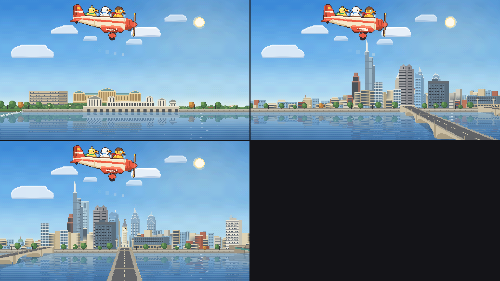
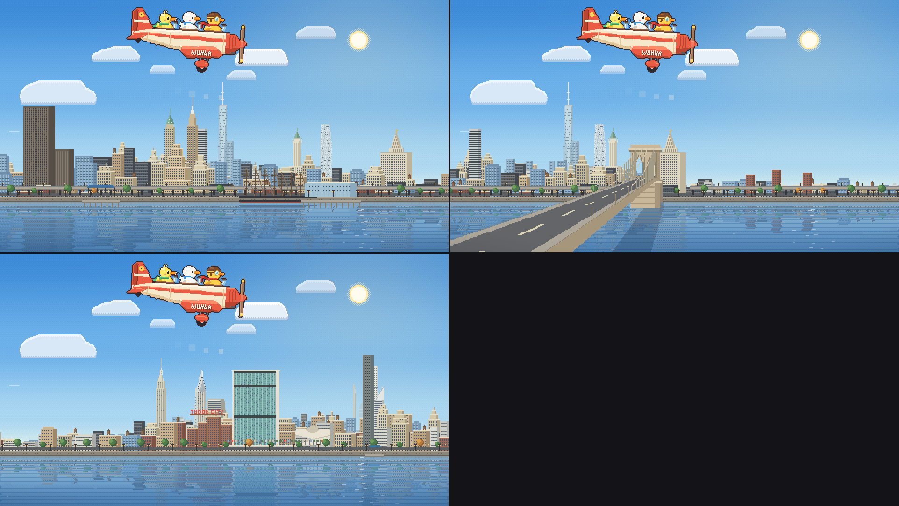
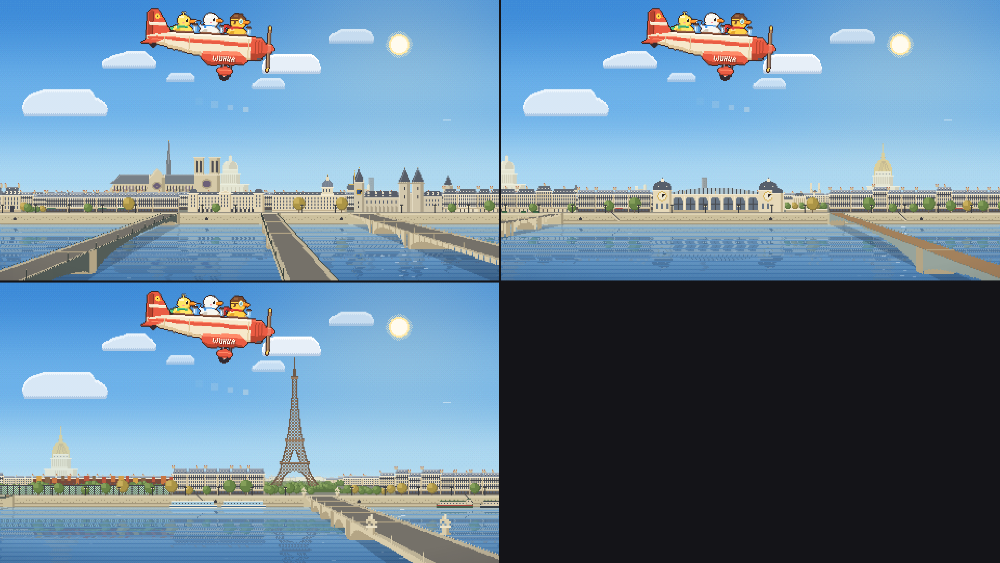
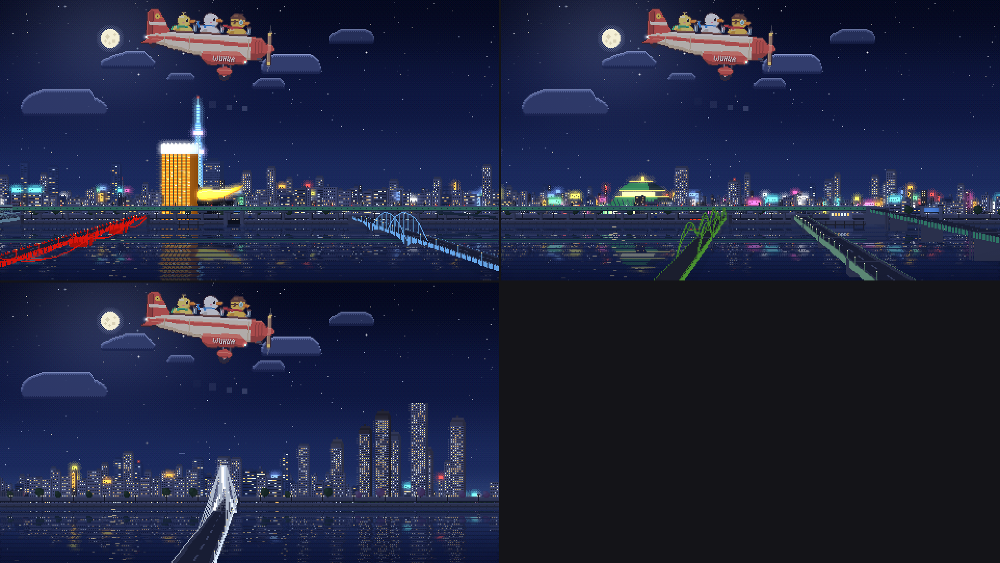
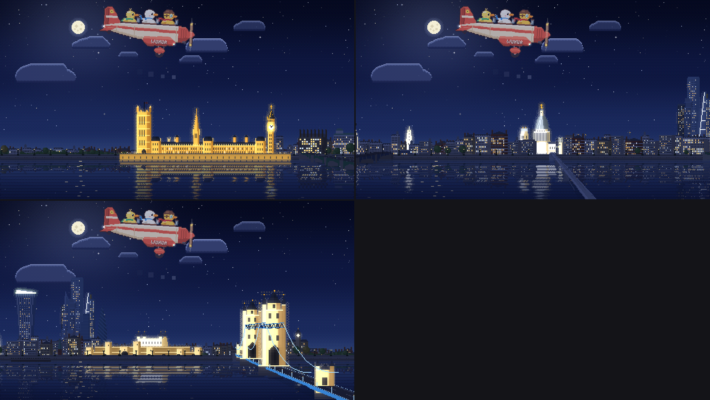

# DuckAir

*by WUHUA*

Three ducks — Captain, Pip and Dot — fly a little propeller plane along real river routes through five cities, in cozy pixel art.

**[▶ Fly now](https://WUHUA52.github.io/duckair/)** (works in any modern browser, desktop or phone)

| | |
|---|---|
|  |  |
|  |  |
|  | |

## The cities

Each city is one real flight line along its river, with landmarks placed from map coordinates:

- **Philadelphia** — down the Schuylkill, looking east at Center City
- **New York City** — up the East River, looking west at Manhattan
- **Paris** — down the Seine, looking south at the Left Bank
- **Tokyo** — down the Sumida, looking east toward the Skytree
- **London** — down the Thames, looking north from Westminster to Tower Bridge

Viewpoints, reference photos and deliberate simplifications: [docs/CITY-REFERENCES.md](docs/CITY-REFERENCES.md).

## Features

- Morning, day, sunset and night; clear, cloudy and rain
- Side, Front, Rear and 3D views (drag to orbit, scroll to zoom)
- A clock (corner or background) in any time zone, with an option to match the sky to the time
- City tour mode, sound, keyboard shortcuts (press `?` in the app)
- Mac wallpaper mode with [Plash](https://sindresorhus.com/plash): unzip `DuckAir-Wallpaper.zip` and follow *Read me.txt*

## Running and building

`index.html` is the whole app in one file, with no dependencies. Open it directly or host it anywhere.

To rebuild from `src/`:

```sh
python3 build.py
```
